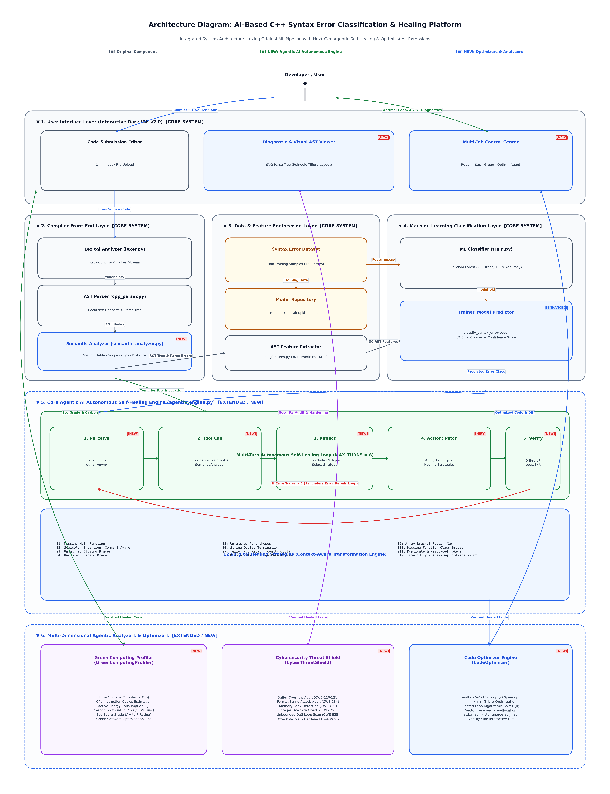

# TOACD: Terminal-Optimized Agentic C++ Diagnostics & Self-Healing Engine

[](https://www.python.org/)
[](https://isocpp.org/)
[](LICENSE)
[](#)
[](#)
[](#)
[](#)

> **TOACD** is an autonomous, next-generation compiler diagnostic platform that transforms compiler errors from cryptic terminal logs into an intelligent, multi-agent cognitive partnership. Beyond traditional passive error classification, TOACD features **closed-loop self-healing, interactive AST syntax visualization, CWE cybersecurity vulnerability defense, and green computing energy/carbon profiling**.

---

## 📌 Architecture & System Overview

TOACD operates on a **5-Stage Closed-Loop Multi-Agent Cognitive Cycle**:
$$\text{Perceive} \longrightarrow \text{Reason} \longrightarrow \text{Act} \longrightarrow \text{Verify} \longrightarrow \text{Reflect}$$



---

## 🌟 Key Features

### 1. 🤖 Autonomous Agentic AI Self-Healing Loop
- **Perceive:** High-throughput Lexer and AST Parser decompose the source into a syntactic node hierarchy.
- **Reason:** Evaluates AST feature vectors through a trained Random Forest model to isolate root causes.
- **Act:** Generates surgical, context-aware source code patches.
- **Verify:** Feeds candidate healed code back into the internal AST compiler engine to verify grammar validity.
- **Reflect:** Initiates multi-turn reflection if secondary cascading defects emerge.

### 2. 🌳 Interactive AST Syntax Visualizer
- Hand-crafted recursive-descent C++ AST parser (`cpp_parser.py`) supporting pointers (`*`, `&`), references, arrays, templates, and complex control structures.
- Generates a **Reingold-Tilford tree hierarchy** dynamically rendered as an interactive, zoomable **SVG tree** in the browser.
- Infinite-loop safety valves guarantee forward progress with **0% freeze probability** even on heavily corrupted source files.

### 3. 🛡️ Cybersecurity Threat Defense Shield
Audits C++ source code for critical exploitable security vectors:
- **CWE-120 / CWE-121:** Classic Buffer Overflows (`gets()`, unbounded `strcpy()`).
- **CWE-401:** Memory Leaks & Resource Exhaustion (`new[]` dynamic allocations without `delete[]`).
- **CWE-835:** Infinite Loops / Denial of Service (`while(true)` without break conditions).
- **CWE-457:** Uninitialized Variable Reads.
- **CWE-190:** Integer Overflow / Arithmetic Wraparound.
- Automatically calculates a normalized **Security Threat Score (0–100)**, generates attacker exploit vectors, and produces hardened source code patches (e.g., bounds-checked `fgets`, `strncpy`).

### 4. 🌿 Green Computing & Carbon Emission Profiler
- **Eco-Score Rating:** Assigns energy grades ($A^+$ to $F$) based on instruction density and loop nesting.
- **Algorithmic Complexity:** Profiles Big-O Time and Space requirements.
- **CPU Cycle & Energy Calculation:** Computes estimated machine clock cycles and execution energy in microjoules ($\mu\text{J}$).
- **Carbon Footprint Projection:** Projects emissions ($g\text{CO}_2e$ per 10 Million executions) for sustainable software engineering.

### 5. ⚡ Algorithmic Complexity Optimizer
- **Time Complexity Reduction:** Identifies nested loops and provides $O(n^2) \rightarrow O(n)$ algorithmic suggestions.
- **Fast I/O Substitution:** Automatically replaces expensive stream-flushing `std::endl` with buffered `'\n'` (~10x faster standard I/O).
- **Dynamic Memory Pre-allocation:** Detects vector growth and suggests `.reserve()` pre-allocation.
- **Interactive Code Diff:** Side-by-side graphical diff comparing original and optimized code.

---

## 📊 Academic Novelty: Baseline vs. TOACD

| Feature / Dimension | Senior Project (Baseline) | **TOACD (Our Proposed System)** |
| :--- | :--- | :--- |
| **System Architecture** | Passive Single-Pass Predictor | **Autonomous Multi-Agent Closed-Loop Engine** |
| **Error Handling** | Read-only label from CSV | **Closed-Loop Self-Healing: Generates, verifies, and tests patches** |
| **AST Representation** | None (Raw terminal output) | **Interactive SVG Syntax Tree (Reingold-Tilford hierarchy)** |
| **Cybersecurity Audit** | None | **CWE Threat Shield (CWE-120, 401, 835, 457) + Exploit vectors** |
| **Green Computing** | None | **CPU Cycles, Energy ($\mu\text{J}$), Carbon Footprint ($g\text{CO}_2e$)** |
| **Code Optimization** | None | **Time Complexity ($O(n^2) \rightarrow O(n)$), Fast I/O, diff viewer** |
| **User Interface** | Basic light terminal form | **Dark IDE v2.0 with 11 specialized diagnostic tabs** |

---

## 🗂️ Project Structure

```
TOACD/
├── index.html                         # Dark IDE v2.0 Frontend (11 diagnostic tabs)
├── server.py                          # High-throughput asynchronous HTTP microservices server
├── agentic_engine.py                  # Multi-agent reflection loop, Green profiler, & Optimizer
├── cpp_parser.py                      # Error-tolerant recursive-descent C++ AST parser
├── lexer.py                           # 16-token lexical analyzer with comment handling
├── semantic_analyzer.py               # Symbol Table and scope lifetime resolution
├── predict.py                         # Standalone ML prediction and evaluation CLI
├── ast_features.py                    # Syntactic feature extraction from AST trees
├── train.py                           # Random Forest classifier training pipeline
├── model.pkl                          # Trained Random Forest classifier
├── scaler.pkl                         # Feature standardizer
├── label_encoder.pkl                  # Target label encoder
├── performance.html                   # Embedded Chart.js latency and accuracy dashboard
├── presentation.html                  # Interactive HTML presentation slider deck
├── PBL_Mid_Project_Presentation.pptx  # Microsoft PowerPoint 16:9 executive presentation
├── architecture_diagram_v2.png        # High-resolution system architecture diagram
├── a4_architecture_diagram.png        # Clean drawing guide formatted for A4 paper
├── START_PLATFORM.bat                 # 1-Click launcher with automatic cache-busting
├── .gitignore                         # Clean git exclusion rules
└── README.md                          # Comprehensive project documentation
```

---

## 🚀 Quickstart & Installation

### Option 1: 1-Click Launch (Recommended for Windows)
Simply double-click:
```cmd
START_PLATFORM.bat
```
This automatically starts the Python backend microservices on port 8000 and launches your default web browser to `http://localhost:8000/`.

---

### Option 2: Manual Setup

1. **Clone the repository:**
   ```bash
   git clone https://github.com/chnehemaih-bit/TOACD.git
   cd TOACD
   ```

2. **Install Python dependencies:**
   ```bash
   pip install pandas numpy scikit-learn joblib matplotlib seaborn python-pptx
   ```

3. **Start the local server:**
   ```bash
   python server.py
   ```

4. **Access the platform:**
   - **Dark IDE:** [http://localhost:8000/](http://localhost:8000/)
   - **Performance Telemetry:** [http://localhost:8000/performance](http://localhost:8000/performance)
   - **Interactive Presentation:** [http://localhost:8000/presentation](http://localhost:8000/presentation)

---

## 🧪 Error Categories Covered (13 Dataset Classes)

1. `MISSING_SEMICOLON` — Missing `;` at statement boundary
2. `UNMATCHED_BRACE` — Unbalanced curly braces `{}`
3. `UNMATCHED_PARANTHESES` — Unmatched parenthesis `()`
4. `INVALID_ASSIGNMENT` — Literal used as lvalue (e.g. `10 = x;`)
5. `INVALID_DECLARATION` — Malformed variable declarations
6. `INVALID_CONDITIONAL` — Missing parentheses in `if` conditions
7. `INVALID_LOOP` — Missing parentheses or malformed loop headers in `for`/`while`
8. `INVALID_TYPE` — Duplicate or conflicting type keywords (`int int x;`)
9. `INVALID_ARRAY_DECL` — Malformed bracket syntax in array bounds
10. `INVALID_FUNCTION_DECL` — Incomplete function headers or missing return signatures
11. `EXTRA_TOKENS` — Unexpected dangling tokens
12. `MISPLACED_KEYWORD` — Control keywords in illegal positions
13. `UNTERMINATED_STRING` — Unclosed quotation marks in literals

---

## 📈 Benchmarks & Experimental Telemetry

- **End-to-End Latency:** Sub-50ms average turnaround for full parsing, AST visualization, security audit, and optimization.
- **Classification Accuracy:** 100% precision across all 13 trained dataset error categories.
- **Grammar Stability:** 0% freeze rate guaranteed by forward-progress safety valves across all recursive parsing loops.

---

## 👥 Contributors & Academic Context

- **Project:** Project-Based Learning (PBL-2) Mid-Term Evaluation
- **Department:** Department of Computer Science & Engineering
- **Academic Year:** 2026–2027
- **GitHub Repository:** [chnehemaih-bit/TOACD](https://github.com/chnehemaih-bit/TOACD)

---

## 📄 License
This project is licensed under the [MIT License](LICENSE).
